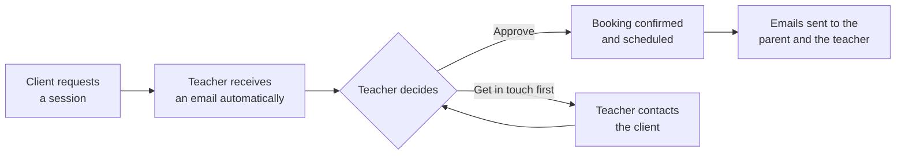

#  Tutoring Booking Platform

**Booking and client management for a live tutoring business, built and run by me as sole developer.**

> The source code is private because it runs a live business with real client data. This repository describes the project. I'm happy to walk through the code in person.

---

**Client-facing site (live):** [thecustomclassroom.co.nz](https://www.thecustomclassroom.co.nz/)

## The problem

Bookings, approvals and follow-ups were all handled manually. The business needed clients to be able to request sessions easily, while the teacher stayed in control of what actually went into the schedule.

## My role

**Sole developer across the full lifecycle:** design, build, deployment and ongoing support. The platform is in active production today.

## What I built

- **Client-facing site** where clients request sessions
- **Teacher dashboard** for reviewing and managing bookings, and blocking out times when the teacher isn't available. Teachers with admin rights use the same dashboard to run the business: they allocate classes and can see every teacher's calendar.
- **Parent dashboard** where parents log in to view their bookings and free assessments, update their children's year level and date of birth, change their phone number and turn on multi-factor authentication (MFA). On first login they swap the temporary PIN from their confirmation email for their own strong password.
- **Serverless backend** that handles booking requests, notifications and business workflows
- **Scheduled automations** that run routine jobs automatically
- **A secured database**, where every row is protected by Row Level Security

## Configurable and ready to grow

- **Fits any lesson-based business.** The whole site is configurable from the Settings area of the admin teacher's dashboard: branding, page wording, what's on offer, payment packages, booking and assessment options, contact details and email templates, plus backups. Each section can be shown or hidden, so it could just as easily run private dance lessons or music tuition as tutoring.
- **One teacher or a whole team.** Add more teachers and the menu switches to "Meet the team", listing everyone automatically.
- **Admin teachers run the schedule.** They assign each booking to a teacher and accept it, and can see every teacher's calendar in one place. A teacher's blocked-out times decide whether they're available for that day and time.
- **Teachers control their own time.** Each teacher can block out times when they're not available, and the system automatically stops classes being assigned to them at those times.

## Stack

| Area | Technology |
| --- | --- |
| Backend | TypeScript serverless functions on Supabase |
| Database | PostgreSQL with Row Level Security |
| Address lookup | Google Maps Platform API |
| Automation | Scheduled YAML-based GitHub Actions pipelines |
| Tooling | Claude Code, used throughout design, implementation, testing, debugging and optimisation |

## How a booking flows

The workflow is automated, but approval stays in human hands. Nothing goes into the schedule without the teacher's say-so.

## Key decisions

**A person approves every booking.**
Automation handles the routine work (capturing requests, sending emails and confirmations), but the teacher makes the call. That keeps the business personal and avoids double-bookings or sessions that don't suit.

**Security in the database, not just the app.**
Row Level Security policies in PostgreSQL decide who can see and change each row. Even if a request reaches the database directly, users can only access their own data.

**Automate the repetitive work.**
Scheduled GitHub Actions pipelines handle routine jobs, so the business doesn't depend on someone remembering to do them.

## Behind the scenes

The client-facing site is live at [thecustomclassroom.co.nz](https://www.thecustomclassroom.co.nz/), so you can view it for yourself. These screenshots show the parts visitors don't see: where booking requests are reviewed, the teacher and parent dashboards, teacher availability, the settings that make the site configurable, and the emails that drive each booking.

*Screenshots use demo data. No real clients, students or contact details are shown.*

| Booking request form | Request received |
| --- | --- |
|  |  |

| Booking request email | |
| --- | --- |
|  | |

| Pending bookings ready for review | Assign a teacher and accept |
| --- | --- |
|  |  |

| On accept: email to the teacher | On accept: email to the parent |
| --- | --- |
|  |  |

| Teacher dashboard: booking confirmed | Parent first login |
| --- | --- |
|  |  |

| Parent dashboard | |
| --- | --- |
|  | |

| Teacher availability | Admin settings |
| --- | --- |
|  |  |

## Status

Live in production and actively supported.

---

**Mercia Zaayman**, Senior Software Engineer | AI-Assisted Engineer · [Portfolio](https://mercia-coder.github.io/Portfolio/) · [LinkedIn](https://linkedin.com/in/mercia-zaayman)

© Mercia Zaayman. All rights reserved. This repository is shared for viewing only.
