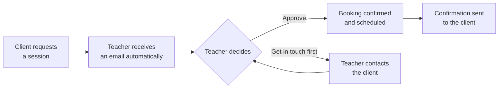

# Tutoring Booking Platform

**Booking and client management for a live tutoring business, built and run by me as sole developer.**

> The source code is private because it runs a live business with real client data. This repository describes the project. I'm happy to walk through the code in person.

---

## The problem

Bookings, approvals and follow-ups were all handled manually. The business needed clients to be able to request sessions easily, while the teacher stayed in control of what actually went into the schedule.

## My role

**Sole developer across the full lifecycle:** design, build, deployment and ongoing support. The platform is in active production today.

## What I built

- **Client-facing site** where clients request sessions
- **Teacher portal** for reviewing and managing bookings
- **Admin portal** for managing the business
- **Serverless backend** that handles booking requests, notifications and business workflows
- **Scheduled automations** that run routine jobs automatically
- **A secured database**, where every row is protected by Row Level Security

## Stack

| Area | Technology |
| --- | --- |
| Backend | TypeScript serverless functions on Supabase |
| Database | PostgreSQL with Row Level Security |
| Automation | Scheduled YAML-based GitHub Actions pipelines |
| Tooling | Claude Code, used throughout design, implementation, testing, debugging and optimisation |

## How a booking flows

The workflow is automated, but approval stays in human hands. Nothing goes into the schedule without the teacher's say-so.

## Key decisions

**A person approves every booking.**
Automation handles the routine work (capturing requests, sending emails and confirmations), but the teacher makes the call. That keeps the business personal and avoids double-bookings or sessions that don't suit.

**Security in the database, not just the app.**
Row Level Security policies in PostgreSQL decide who can see and change each row. Even if a request reaches the database directly, users can only access their own data.

**Automate the repetitive work.**
Scheduled GitHub Actions pipelines handle routine jobs, so the business doesn't depend on someone remembering to do them.

## Screenshots

*Screenshots use demo data. No real clients, students or contact details are shown.*

| Admin portal | Teacher portal |
| --- | --- |
|  |  |

| Booking request email | Booking confirmation |
| --- | --- |
|  |  |

## Status

Live in production and actively supported.

---

**Mercia Zaayman**, Senior Software Engineer | AI-Assisted Engineer · [Portfolio](https://mercia-coder.github.io/Portfolio/) · [LinkedIn](https://linkedin.com/in/mercia-zaayman)

© Mercia Zaayman. All rights reserved. This repository is shared for viewing only.
